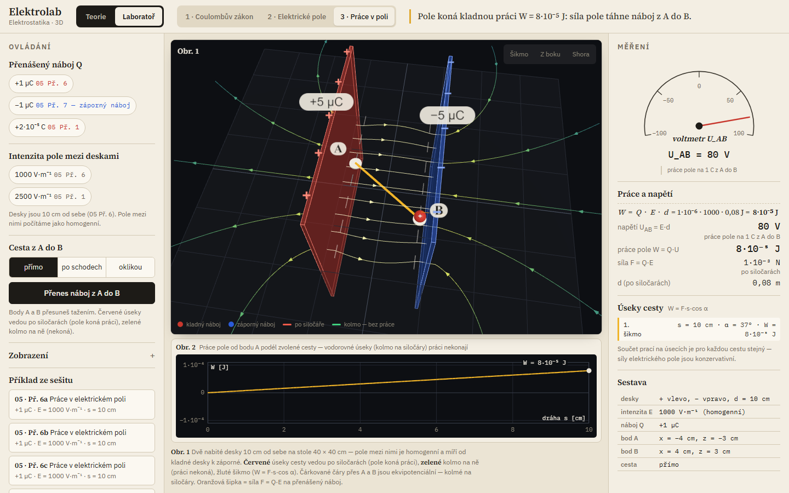

# Elektrolab

**A 3D electrostatics lab built to match my physics class. Every example from our notebook is an automated test.**

[Open the app](https://quandevcz.github.io/elektrolab/) · [Read the case study](https://quandevcz.github.io/elektrolab/case-study.html)



I built Elektrolab for my class at a Czech gymnázium. Drag charges around and the force arrows, field
lines and numbers update live. The app is in Czech on purpose: it uses the exact symbols, formulas and
examples our teacher used, so it can be shown in class.

- **Theory:** 5 chapters in lesson order (charge and Coulomb's law, permittivity, electric field,
  field strength, work in a field). Each one has the formula with live numbers from the scene.
- **Notebook examples:** 15 tasks from class, rebuilt as scenes. The solution stays hidden until you click.
- **Lab:** every control, graphs of force and field strength, an analog gauge, a setup table.
- **Accuracy:** each notebook example is a test that must round to the notebook's answer. 84 tests, 0 failing.

**Tech:** plain HTML, CSS and JavaScript, no build, no dependencies. Three.js r160 from a CDN, hand-made
canvas graphs and an SVG gauge. All physics lives in `src/core/` (no DOM), tested with `node --test`.
Works with a mouse or a finger. Built with Claude Code.

```bash
npm start      # http://localhost:4340
npm test       # physics checked against the notebook examples
```

---

## Česky

Interaktivní 3D elektrostatika pro gymnázium — fyzika se **ukazuje**, ne jen píše.

**Živě:** https://quandevcz.github.io/elektrolab/

**Etapa 1: Coulombův zákon a permitivita prostředí**

- Přidávej kladné a záporné náboje a přesouvej je tažením (myš i prst na iPhonu).
- Šipky ukazují výslednou elektrickou sílu na každý náboj, siločáry vedou od + k −.
- Panel Měření počítá F_e = 1/(4·π·ε)·Q₁·Q₂/r² živě, včetně dosazení čísel jako v sešitě.
- Prostředí (vakuum, vzduch, petrolej, porcelán, ethanol, voda) podle tabulky εᵣ z hodiny.
- Tlačítko „Dotkni se“ ukáže zákon zachování elektrického náboje.
- „Příklad ze sešitu“ postaví příklad z hodiny a porovná výsledek se sešitem.

**Etapa 2: Elektrické pole**

- Vektory intenzity E v mřížce — všechny stejně dlouhé, velikost pole ukazuje barva
  (světlejší = silnější, logaritmická stupnice s legendou), stejně jako v lekci 04.
- Typy pole: radiální, dipól, homogenní (dvě nabité desky).
- Bod P: přetáhni ho kamkoli a uvidíš intenzitu v tom místě („síla na 1 C“).
- Živé dosazení F = Q·E pro vybraný náboj; příklad 04 Př. 1 s variantami a)–d).

**Etapa 3: Teorie, Laboratoř, práce v poli**

- **Teorie** (otevře se jako první): pět kapitol v pořadí lekcí — náboj a Coulombův zákon,
  permitivita, elektrické pole, intenzita, práce v poli. U každé kapitoly: co to je, vzorec (a pod ním
  čísla ze scény), ovládání scény a příklad ze sešitu — řešení se ukáže až po kliknutí a příklad se
  dá postavit ve scéně. Šipky ←/→ listují kapitolami.
- **Co je náboj?** tření ebonitové tyče o hadr: elektrony přejdou na tyč, celkem pořád 0 (lekce 02).
- **Relativita a absolutismus** (z hodiny, mimo sešit): 1 AU = vzdálenost Země–Slunce ≐ 150 000 000 km,
  všech osm planet v AU i v km (vnější planety v menším měřítku); souvislost s εᵣ (vůči vakuu)
  a potenciálem (vůči Zemi).
- **Práce v poli** (lekce 05, 06): dvě desky 10 cm od sebe, body A a B, cesta přímo / po schodech /
  oklikou — jiná cesta, stejná práce. Příklady 05 Př. 6a–c a Př. 7.
- **Laboratoř:** grafy Obr. 2 a 3 (Fₑ(r), |E| podél přímky, práce podél cesty), ručkový přístroj
  (siloměr, |E|, voltmetr) a tabulka Sestava.
- Odkazy: `?kapitola=prace`, `?lab=pole` …

## Spuštění

```bash
npm start      # http://localhost:4340
npm test       # fyzika ověřená na příkladech ze sešitu
```

Bez instalace a bez build kroku: čisté HTML + CSS + JavaScript, Three.js z CDN.

## Plán

1. Coulombův zákon ✓
2. Elektrické pole ✓
3. Průvodce + Laboratoř + práce v poli ✓
4. Potenciál — ekvipotenciální plochy, „kopec“ potenciálu
5. Lekce s přehledem veličin (přehled z lekce 06 už je ve „Víc k tématu“ kapitoly 5)
